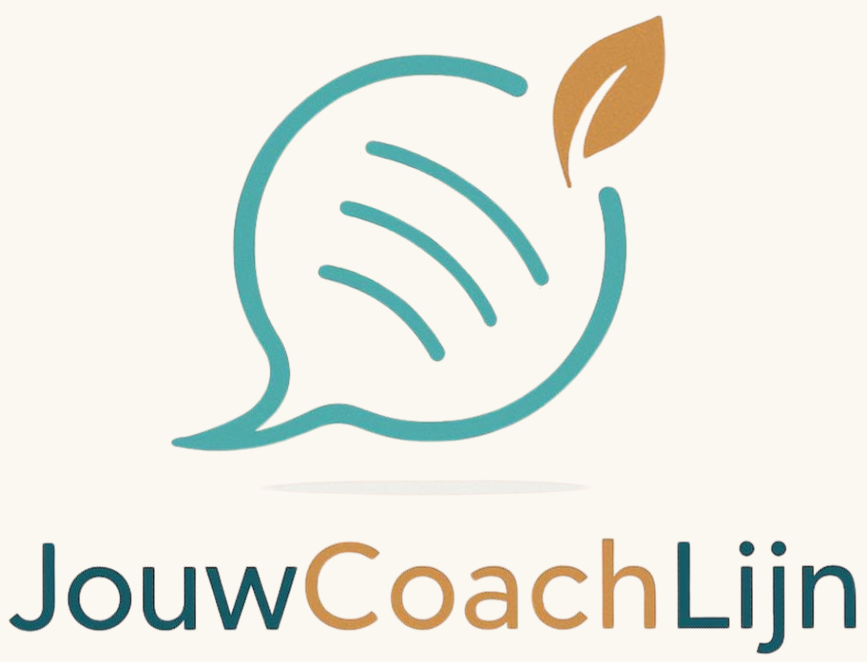

# **De wereld mag weer wat zachter en dat begint bij jouw binnenwereld.**

Mensen ontdekken veel vaker dat er iets niet klopt, dat gevoelens schuren en je langzaam niet lekker in je vel komt te zitten.
Hiervoor vlieg je niet direct naar de psycholoog en in jezelf blijft het sudderen en zijn er steeds meer omstandigheden die zorgen laten opstapelen die je niet kan plaatsen.
Je wil niemand tot last zijn en toch zit jou veel dwars wat je niet kan plaatsen.
De wachtlijsten bij de GGZ zijn lang, je bent wat vaker moe of je hoofd maakt overuren, maar je "moet" door.

Het kan zo fijn hebben om altijd direct met iemand te kunnen spreken, waar je veilig kan openen en je even kan vertragen en stil kan staan, even kan ademen en je verhaal kwijt bij een professional die er helemaal voor jou is, je nieuwe inzichten geeft en jij weer nieuwe ruimte kan voelen.
Een vaste plek waar er 24 uur per dag iemand voor je is.

De grootste groei ontstaat juist in de emoties die wringen, pijn doen of verdriet of angst geven. 

***Van daaruit is [JouwCoachLijn](www.jouwcoachlijn.com) ontstaan.***

Want hoe fijn is het als je dagelijks een eigen lifecoach tot je beschikking hebt op elk gewenst moment van de dag?

Drenthe-bewust laat je graag in contact komen, met JouwCoachLijn, want wij werken toe naar "*Een nieuwe generatie die leeft van binnenuit — vol vertrouwen, verbonden en bruisend van levenslust".* 

Bij Drenthe-bewust geloven we erin dat je met de juiste mensen om je heen bewustwording kunt creëren en vandaaruit keuzes kunt maken en kan groeien naar een (zelf)bewuster, gelukkiger en gezonder leven. 

JouwCoachLijn is een verlengstuk van professionals die mensen begeleiden in het leven vanuit diverse specialiteiten kiezen ervoor om ook op deze laagdrempelige manier kennis te maken met jou, je op weg te helpen naar richting, doelen en nieuwe focus.
Gewoon direct telefonisch te bereiken, geen gedoe, gewoon bellen en je coach kiezen. 
Een band mee opbouwen, jezelf niet opnieuw uit hoeven te leggen maar iemand die jou positief aanmoedigt in het leven en de dagelijkse omstandigheden.

## **Deze lijn is werkelijk voor iedereen, van examen stress tot diep trauma.**

Het specifieke aan deze lijn is dat hier consulten werken met een holistische en spirituele levensvisie. 
Wij willen geen afhankelijkheid creëren en geloven dat er niet maar 1 manier is, iedereen is uniek en iedereen mag landen in de kracht die zij zelf altijd al zijn geweest. De weg is van binnen naar buiten en daar helpen we mensen met alle liefde mee om een dieper bewustzijn zichtbaar te maken zodat mensen weer emotioneel contact maken met zichzelf en de regie weer over hun eigen leven durven te nemen.

### **Goed om te weten:**

JouwCoachLijn wordt niet door een overheid gestimuleerd of gefinancierd en is daarom een betaalde telefoonlijn die wij in kosten zo laag mogelijk hebben kunnen houden.
Je belt met 0900-1881 en betaalt € 0,80 per minuut en om je kosten te beschermen stopt een gesprek automatisch na 50 minuten. 
Op www.jouwcoachlijn.com vind je alle consulenten, in hun profiel zijn ook hun praktijken te vinden, wanneer je de behoefte voelt om na een fijn gesprek verder te willen groeien in een traject met de coach van jouw keuze, dan kan dat!

Dit initiatief ligt bij Richard van [InnerForceCoaching](www.innerforcecoaching.nl) en Denise van [Manifestatiekracht](www.manifestatiekracht.nu) 
2 bezielde mensen die als geen ander weten hoe transformatie werkt en het iedereen gunnen om weer te leven in plaats van te overleven. 
Waar spiritualiteit en bewustwording voor jaren geleden nog een zweverig imago had, is de behoefte naar innerlijke groei groter dan ooit, iedereen mag zijn plaats innemen in deze wereld, zelfliefde is de bron van al het leven.
Zij zien het als de reden waarom zij hier zijn om een plek te bieden waar mensen al hun kwetsbaarheid durven te uiten en meer levensgeluk kunnen ervaren.

